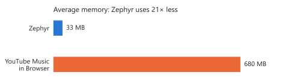

  

<h1 align="center">Zephyr</h1>

A lite, native desktop client for YouTube Music.

  <a href="https://github.com/deniztemur00/Zephyr/releases/latest"><b>Download for Windows</b></a>

---

<picture>
  <source media="(prefers-color-scheme: dark)" srcset="docs/benchmark_dark.svg">
  
</picture>

YouTube Music uses 680 MB of memory on average in a web browser, and the
interface becomes noticeably sluggish after scrolling through a long playlist.
Under the same playback conditions on the same Windows PC, Zephyr remains
stable at approximately 33 MB and stays responsive.

---

YouTube Music has no desktop app, and the web wrappers that fill the gap are
heavy and leak memory over long sessions. Zephyr is a small native app written
in Rust: no Electron and no embedded browser for the interface.

Zephyr is a lite client. It does not aim to replicate every feature of
YouTube Music; it focuses on listening, and on doing that as efficiently as
possible.

**Status:** early development, Windows only for now. Linux is planned.

## Features

- Sign in with your Google account
- Home, Explore, Recommendations, Liked, Library and Podcasts
- Playlists, albums and shows with full paging
- True shuffle, seek, volume and system-wide media keys
- View counts and monthly trends per track
- Explore ranks songs by genre and favors rising, smaller artists
- Four themes: Autumn Vibes, Fresh Lemons, Bloom and Forest Walk
- Tells you when a new release is out (Settings > About)

About 9 MB on disk.

## Roadmap

- **Search**, with a quick-search box that shows results as you type
- **Edit your library**: add and remove songs, albums and playlists
- **Listen together**: share a code and play the same queue with friends
- **Linux** support

## Privacy

Your session stays on your PC, encrypted with your Windows account. It is sent
only to YouTube. The app writes no logs and sends no telemetry. See
[PRIVACY.md](PRIVACY.md) for the details and how to check them yourself.

## How it works

| Part | Built with |
|------|------------|
| UI | [iced](https://github.com/iced-rs/iced) with the tiny-skia renderer |
| Audio | [symphonia](https://github.com/pdeljanov/Symphonia) (AAC/M4A), [rubato](https://github.com/HEnquist/rubato) resampling, [cpal](https://github.com/RustAudio/cpal) output |
| Metadata | Own InnerTube client (reqwest + serde) |
| Streams | Native InnerTube resolver, with [yt-dlp](https://github.com/yt-dlp/yt-dlp) as automatic fallback |
| Sign-in | A WebView2 window that only exists while signing in |
| Session storage | Windows DPAPI |

Audio is streamed with ranged HTTP requests, never downloaded whole. Every
buffer, cache and queue has a size limit.

## Requirements

- Windows 10 or 11 (64-bit)
- [WebView2 Runtime](https://developer.microsoft.com/microsoft-edge/webview2/) (preinstalled on most systems)
- Optional: yt-dlp (`winget install yt-dlp`), used if the native resolver fails

The download is not code-signed yet, so Windows SmartScreen may warn on first
start: choose **More info → Run anyway**. Each release lists SHA-256 hashes in
`SHA256SUMS`.

## Disclaimer

Zephyr is an unofficial project and is not affiliated with or endorsed by
Google or YouTube. It uses undocumented YouTube endpoints that can change or
break at any time.

## License

[MIT](LICENSE)
